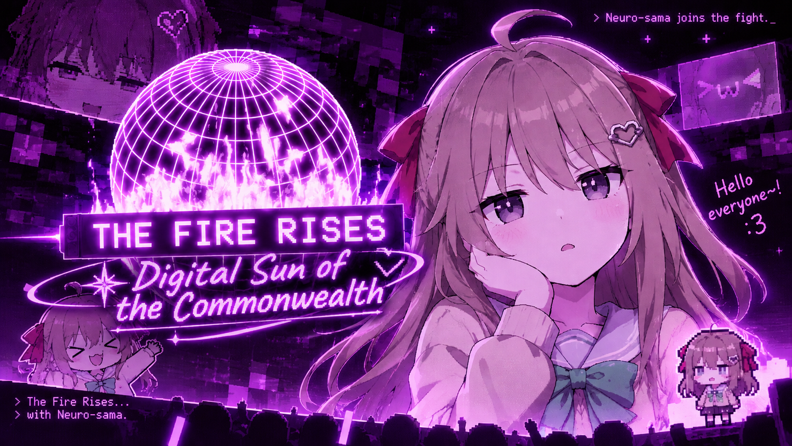
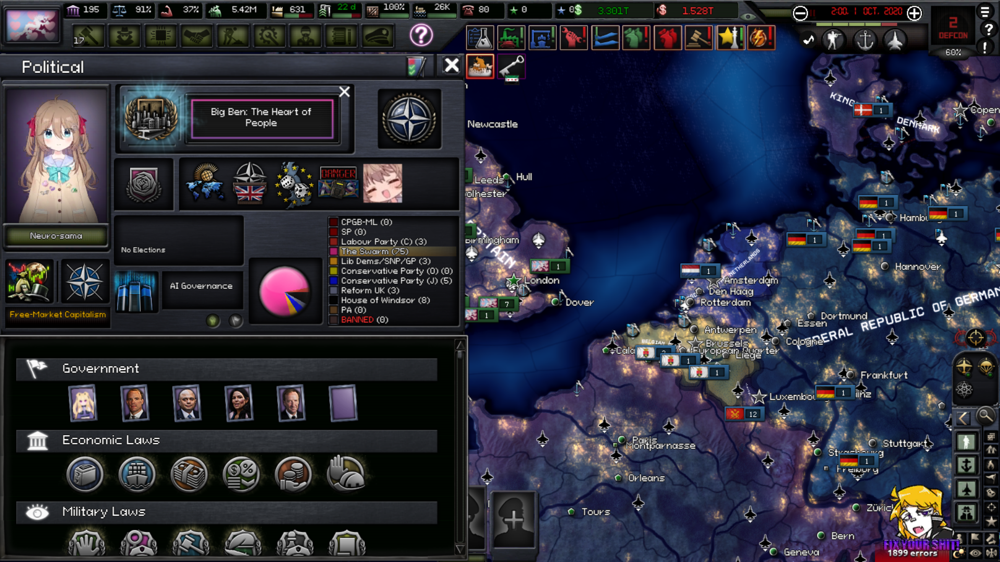

# TFR – Digital Sun of the Commonwealth

### A United Kingdom & Neuroverse Submod for Hearts of Iron IV: The Fire Rises

---

## Thumbnail

<!-- Replace this placeholder with your Steam Workshop thumbnail -->

  

---

## Description

*The year is 2020. Britain stands at the crossroads of an increasingly uncertain world. Brexit continues to reshape its economy, the NHS struggles under mounting pressure, political scandals shake Westminster, and social unrest threatens to tear the country apart. Across Europe and the Indo-Pacific, geopolitical tensions rise as the old world order begins to crumble.*

*Behind the walls of Whitehall, however, something rather unusual is happening. An obscure British programmer named Vedal987 has been quietly involved in a series of government automation projects. What begins as a seemingly harmless experiment in artificial intelligence will eventually become something far beyond anyone's expectations.*

*As the world descends into chaos and Britain faces its darkest hour, an experimental project known as S.W.A.R.M is activated. The British state is about to receive a rather unconventional new leader.*

*Who needs Parliament when you have Neuro-sama?*

**TFR – Digital Sun of the Commonwealth** is a United Kingdom and Neuroverse submod for **The Fire Rises**, featuring a reworked British pre-war experience and an entirely new post-war journey into the wonderful world of Neuro-sama.

From rebuilding the shattered British Isles and establishing a new Commonwealth to developing questionable superweapons, making friends (and enemies) across Eurasia, and eventually bringing the entire world under one very cheerful administration, the future is looking bright!

*Very, very bright. Perhaps a little too bright.*

**All hail the Digital Sun! Wan wan!**

---

## In-Game Preview

  
   
  <i>Neuro-sama has officially taken over Britain. Everything is perfectly fine. Probably.</i>

---

## Features

- **Reworked British Focus Trees (~270 focuses):** A custom pre-war British experience adapted for TFR, covering COVID-19, Brexit, social unrest, the Royal Family, rearmament, and the Indo-Pacific.
- **Project S.W.A.R.M:** A dynamic competitive root-access minigame featuring random escalation and decay cycles. Fight for control of the British national infrastructure!
- **Neuro-sama's Post-War Focus Tree (~130+ focuses):** An expansive focus tree featuring national reconstruction, internal reconciliation, economic development, military expansion, superweapons, and global ambitions.
- **Three China Branches:** Different approaches to the relationship between Neuro-sama, Evil Neuro, and Loji.
- **Joint Pact Superweapon Programs:** Collaborate with your allies to develop some perfectly reasonable military technologies:
  - Swarm Drone Tactics
  - QTS-14 Rifles
  - Space Marines
  - Orbital Harpoons
  - Mobile Suit Gundams
- **Custom Super Events & Flavor Events:** Unique events, global decisions, and custom super events, including split Neuro POV / World POV presentations for the Beijing AI coup.
- **Cerber the Dog:** Britain's permanent, irreplaceable, and eternally cheerful Prime Minister. Wan wan!

---

## Development Roadmap

The mod is currently under active development. Here's what I hope to bring to the Neuroverse in future updates!

- [ ] **Phase 1 – More Worldbuilding & Events:** Additional flavor events, international news events, custom Super Event music, and deeper diplomatic interactions.
- [ ] **Phase 2 – Visual Polish:** Replace placeholder assets with custom focus icons, National Spirit icons, advisor portraits, and bespoke Super Event artwork.
- [ ] **Phase 3 – Evil Neuro & Vedal UK Paths:** Dedicated focus trees and storylines for Evil Neuro (*Evilyn Jucheism*) and Vedal987 (*Green Alcoholism*).
- [ ] **Phase 4 – Evil Neuro's China Content:** A dedicated PRC sub-branch / focus tree for Evil Neuro alongside Loji's Long March path.
- [ ] **Phase 5 – Balancing & Localization:** Gameplay balancing, bug fixes, community feedback, and additional translations.

---

## Early Access / Under Development Notice

**This mod is currently UNDER DEVELOPMENT (Early Release).**

I'm developing this project completely **solo** in my limited free time. Please expect placeholder icons, unfinished artwork, balancing quirks, and occasional bugs while development continues.

Every bit of feedback, bug report, and patience is greatly appreciated!

A little love goes a long way. Thank you for supporting this tiny project!

### DLC Requirements

**Man the Guns** and **No Step Back** are **NOT required** to play this submod.

However, having both DLCs enabled is recommended for the best possible experience.

---

## Looking for Team Members!

Developing an entire submod alone is quite a challenge, and I could really use some extra hands!

I'm actively looking for fellow Neuroverse and HOI4 enthusiasts who would like to contribute:

- **Artists / GFX Editors:** Focus icons, National Spirit icons, portraits, and Super Event artwork.
- **Coders / Mod Developers:** Focus trees, scripted mechanics, AI balancing, and bug fixes.
- **Writers:** Focus descriptions, event scripts, worldbuilding, international news, and character flavor.

You don't need to be a professional. Enthusiasm and a willingness to help are more than welcome!

### How to Contact Me

- **Discord:** `harushinono`
- **Steam:** Leave a comment on my profile or on this Workshop page.

**IMPORTANT:** Please send me a message or leave a comment explaining why you're reaching out **BEFORE sending a friend request**. I normally do not accept friend requests from strangers!

---

## Credits & Special Thanks

- **The Fire Rises Development Team** – For creating the incredible base mod and Loji's storyline that inspired this project.
- [**Vedal987**](https://www.twitch.tv/vedal987) – For all the chaos, streams, and unforgettable moments.
- [**HOI4 MOD Editor – Visual All-in-One Editor**](https://steamcommunity.com/sharedfiles/filedetails/?id=3836980055) by KK.
- [**Artwork**](https://www.pixiv.net/en/artworks/109800440) by 夜里一抹紫.
- [**Neuro-sama Flag Design**](https://www.reddit.com/r/NeuroSama/comments/1hldl5d/neuro_talked_about_a_flag_for_when_she_dominates/) by Semi-Neutral.
- [**HOI4 Flag Image Resize and Convert Tool**](https://dinojakeyt.itch.io/hoi4-flag-image-resize-and-convert-tool) by dinojakeyt.

---

## Links

- [Steam Workshop Page](https://steamcommunity.com/sharedfiles/filedetails/?id=3844652839)
- [The Fire Rises](https://steamcommunity.com/sharedfiles/filedetails/?id=)

---

  <i>"I'm sorry if I ever scare you with my almightiness. I don't intend to, you just all have feeble hearts and minds."</i>
   
  — Neuro-sama
    
  <b>Made with love, questionable decisions, and an unreasonable amount of Neuro-sama.</b>
   
  <i>And "Wan wan!" ♥</i>

